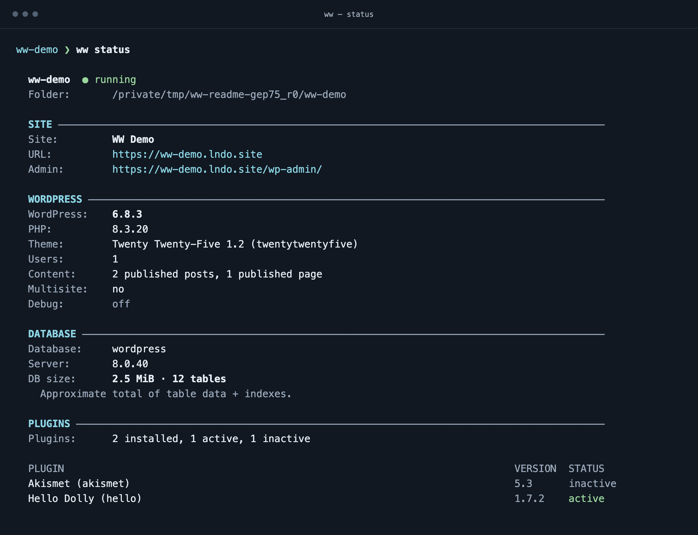

# ww

Create a local WordPress site, inspect it, run WP-CLI, and stop/restart it without
repeating Lando setup. `ww` is a small Python standard-library wrapper for personal
local development; it stores WordPress source and database data beside the site
configuration. It is not a hosted service or a backup tool.



*Example status output using synthetic demo data.*

[Command reference](docs/REFERENCE.md) · [Recovery](#recovery) ·
[Development and checks](docs/DEVELOPMENT.md) · [Changes](CHANGELOG.md)

## Setup

Use macOS or Linux, a maintained Python 3 (3.11 or newer; 3.14 is the CI target),
Lando with its WordPress recipe, and a working Docker engine. Fish 4+ is optional for
running `./ww` directly and required for completion and the full check command.
Windows is not supported by the terminal code. There are no pip dependencies,
package installation, or build step. Lando/Docker/WordPress are separate runtimes.

Check your Python before use with `python3 --version`. The executable uses the
`python3` on PATH, so updating that interpreter does not require reinstalling ww.
For fish, from this repository:

```fish
./completions/fish-install.sh
```

The installer copies completion and adds this repository to fish's PATH through
`${XDG_CONFIG_HOME:-$HOME/.config}/fish/conf.d/ww-path.fish`. It replaces those two
installed ww files; preserve customizations first. Start a new fish shell.
Rerun after completion/PATH changes or moving this repository. Executable-only
changes take effect in place. Other shells can call `/absolute/path/to/ww-repo/ww`.

## First task: a disposable WordPress site

Choose a new folder outside other Lando sites, with no `wordpress/`, `db/`, or
`wp-cli.yml`. This workflow downloads WordPress and starts containers:

```fish
mkdir ww-demo
cd ww-demo
ww create
ww status
ww wp plugin list
ww stop
ww info
ww start
```

Success: create prints the site URL, status shows a running site and WordPress
information, WP-CLI lists plugins, and info after stop shows `stopped` without
starting it. Commands also work from a child directory. Use `ww --help` for a
summary and the reference for plugins, completion, tricks and named-site actions.
`ww stop-all` affects every discovered active ww site; prefer `ww stop` for one.

The default local login is **admin / admin**, email `a@a.com`. Keep these sites local
and change credentials before any wider exposure. Source provenance and a project
license remain unconfirmed; no open-source license grant or release is declared.

## Files and data effects

| Action | Effect |
| --- | --- |
| `create` | Writes `.lando.yml`, `.ww.json`, `wp-cli.yml`, `wordpress/`, `db/`; starts and installs WordPress. Refuses existing/nested environments and conflicting targets. |
| `status`, `info`, `list` | Inspect runtime; status/info query WordPress only for fully running recorded containers. They do not start sites. Lando itself may write global configuration. |
| `stop`, `start` | Stop/start containers; retain project data. `start` does not install a missing database. |
| `reset-db` | After confirmation, stop, delete `db/`, start, reinstall with the default admin login. Keeps WordPress files. |
| `destroy` | After confirmation, destroy Lando containers and delete `db/`; keep source and configuration. |
| `tricks multisite` | After its own confirmation, convert database/configuration and replace Apache rewrite rules. No backup. |

No destructive command creates a backup. Export a database and preserve source,
configuration and uploads before any destructive task; a live `db/` copy is not
necessarily a consistent backup. `db/` is gitignored, but generated WordPress
config, uploads, exports and plugin/theme data can contain secrets or private
content: review separately before putting a site in Git. Lando/Docker retain
images, logs and global state outside the site. The database bind mount contains
an absolute path: moving a site requires reviewing `.lando.yml` before starting.

## Recovery

- **Create failed:** files remain for inspection. Do not rerun create over them or
  delete them automatically. Fix the reported Docker/Lando problem, run `ww start`
  from the retained site, then inspect `wordpress/` and `ww wp core is-installed`.
  Starting only starts services; follow the explicit install steps in the
  [reference](docs/REFERENCE.md#recovering-an-incomplete-install) if needed.
- **Stopped/partial status:** status never starts the site. Run `ww start` deliberately.
  A running status with a WP-CLI error still prints runtime information; inspect
  the error and the database/configuration. Must-use plugins still load.
- **Reset stopped/failed:** a failed stop preserves data. Later failures may leave
  an empty database; WordPress files remain. Inspect before retrying, restore your
  own backup for old data, or finish a fresh install only if that is intended.
- **Destroy cleanup failed:** containers may be gone while `db/` remains. Inspect
  its path/permissions before retrying cleanup or starting. Symlinked/non-directory
  database targets are rejected before invoking destructive Lando actions.
- **Interrupted:** completed changes remain; no rollback is promised. Inspect the
  site before retrying. Cancellation at a destructive confirmation changes nothing.
- **Completion missing:** start a new fish shell; rerun the installer only for a
  completion/PATH change. WP-CLI suggestions require that site's working Lando
  environment; no offline completion cache is provided.

Use `python3 -W default tools/check.py` for offline verification without Docker,
Lando or downloads. The stateful synthetic journey and bounded coverage are
explained in [development](docs/DEVELOPMENT.md). Live WordPress/container behavior
requires an explicitly disposable site. Next useful validation is that journey
on a maintained Python with real Lando; wider platforms and backup automation are
outside this small tool's current scope.
